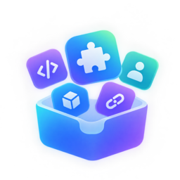
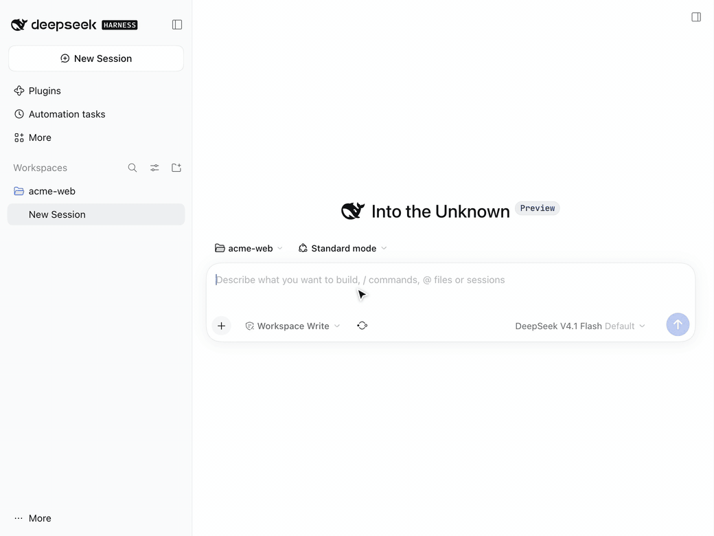
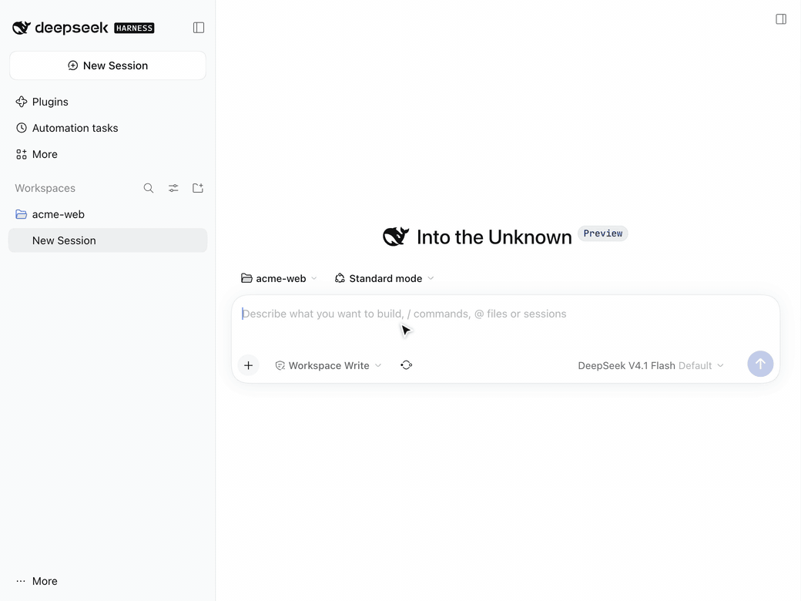

# Agent Plugins

`dsh-agent-plugins-market`

**Skills and extensions manager for [DeepSeek Harness (DSH)](https://github.com/deepseek-ai/deepseek-harness). Install Claude Code, Codex, Cursor and Kimi plugin repositories as they are, without waiting for a DSH port.**

Paste a repository URL and install its suites in place. The plugin reads each layout as it is, so you convert no manifest and copy no file. In the same workspace you manage your own skills, commands, agent personas, MCP services, LSP servers, the system prompt and output styles, and extension presets choose which extensions each session carries.

If this plugin is useful to you, a ⭐ on [GitHub](https://github.com/Sivan757/dsh-agent-plugins-market) is appreciated.

English | [简体中文](README.zh.md) | [Documentation](https://sivan757.github.io/dsh-agent-plugins-market/) | [npm](https://www.npmjs.com/package/dsh-agent-plugins-market)

 

[Demo](#demo) · [Quick start](#quick-start) · [Popular repositories](#popular-repositories) · [Highlights](#highlights) · [Everyday use](#everyday-use) · [Compatibility](#compatibility) · [FAQ](#faq)

## Demo

1. **Add a source.** Paste a repository URL and the market lists its suites.
2. **Install suites.** The plugin reads each suite in place. It converts no manifest and copies no file.
3. **Save a preset.** Open the preset manager beside the composer, save a copy, and keep only the suites this task needs.
4. **Switch presets.** The session carries only the selected extensions, and the `/` menu gets shorter.
5. **Get to work.** One set of extensions serves every session, each with its own selection.

The demo uses the first-party source and [claude-plugins-official](https://github.com/anthropics/claude-plugins-official). Select the animation to open the full-resolution video.

## Quick start

1. In the DSH Web GUI, open **Plugins** in the sidebar.
2. Press **Add plugin**, type `dsh-agent-plugins-market`, then install it. The same dialog accepts a repository URL or a local directory.
3. Restart DSH, then open **Settings → Agent Plugins**.
4. The market already lists one first-party source. Press **Refresh** to fetch its suites. To bring in more, add a source such as `https://github.com/anthropics/claude-plugins-official`.
5. Open a suite, review its contents, then install it and keep it enabled. Skills appear in the **Skills** tab and in the `/` menu. Answer any credential notice on the **Connectors** tab before you use that suite's tools.

Terminal alternative: `dsh plugin --profile <name> add dsh-agent-plugins-market`. Requirements, profile configuration and other install options live in the [install guide](https://sivan757.github.io/dsh-agent-plugins-market/docs/install/#installation-options).

## Popular repositories

A well-known skill repository needs no DSH port. Add the original repository as a source, then install it as it is:

| Repository | The market finds | Source URL |
| --- | --- | --- |
| [obra/superpowers](https://github.com/obra/superpowers) | 15 skills and 1 hook | `https://github.com/obra/superpowers` |
| [mattpocock/skills](https://github.com/mattpocock/skills) | 39 skills | `https://github.com/mattpocock/skills` |
| [JuliusBrussee/caveman](https://github.com/JuliusBrussee/caveman) | 22 skills, 1 command, 3 agent personas and 4 hooks | `https://github.com/JuliusBrussee/caveman` |
| [anthropics/skills](https://github.com/anthropics/skills) | 19 skills | `https://github.com/anthropics/skills` |
| [anthropics/claude-plugins-official](https://github.com/anthropics/claude-plugins-official) | 318 suites, 57 of them in the repository itself | `https://github.com/anthropics/claude-plugins-official` |

The counts are from 2026-11-18 and change as each repository does. The market lists what a suite holds before you install it. A skill file the market cannot read is listed as disabled instead of being dropped.

## Highlights

### Core

- **Any skill repository works.** Add a Git URL whose repository holds `skills/<name>/SKILL.md` and the market discovers it as a suite. No manifest, no conversion, no file copying.
- **Ten suite layouts.** Claude Code, Codex, Cursor, Kimi Code, ZCode, Qoder CLI, GitHub Copilot CLI, Universal `.plugin/`, [agent-plugins](https://agent-plugins.org) and manifest-less skill collections.
- **Sources and downloads.** Add a Git repository, a local directory or an archive, adopt a checkout you cloned yourself, and refresh on demand. Pick a global or China mainland mirror, and refresh every source on a 6-hour timer if you want.
- **Runtime injection.** Enabled suites add skills to the catalog and slash menu, commands as `/name`, agent personas to the subagent catalog, MCP tools as `mcp__*`, hooks to lifecycle events, and language servers to the `lsp` tool. Installing the plugin is the whole LSP setup.
- **One workspace.** Nine tabs cover the market, the instructions injected into a session, the output style that shapes each answer, the resources you author, and the services that run. Every tab has search, filters and a grid or list view.
- **Extension presets, chosen per session.** Save a set of suites, skills, experts, shortcuts and services as a preset, and switch it beside the composer. The session carries only what the preset selects, and the global switches stay as they are. See [Session extension presets](https://sivan757.github.io/dsh-agent-plugins-market/docs/settings/#session-extension-presets).

### Advanced

- **MCP OAuth with nothing to declare.** A remote MCP server that answers `401` starts RFC 9728 discovery, dynamic client registration and PKCE authorization in your browser, and the granted token persists. OAuth is on by default, so a suite needs no declaration for it.
- **Per-server MCP control.** Override a declaration without editing its source, switch one tool off, and set the tool-call and startup timeouts.
- **MCP health that reaches the conversation.** A server that drops its connection reports the retry, its suite and the last error in the chat, and while it is unavailable the model's prompt names the missing tools, so an answer says what is gone instead of silently working around it.
- **Project and personal resources.** Turn on **Scan project Agent layouts** to read skills, commands, roles, MCP servers and hooks from the project's own directories. Author your own under `~/.agents/` as Markdown, and disable a resource without deleting its file.
- **Per-workspace control.** Each workspace switches the six mounted surfaces off or on, keeps its own resource filters, saves a resource-window setup as a favorite that works across projects, and stows tabs it does not need into the menu at the end of the tab row.
- **Hooks that decide, not just observe.** Ten events apply what the hook returns: tool deny, ask and allow, added context, corrective feedback, a forced continuation, and a real halt for `continue: false`. A hook row opens a declaration card with its event, matcher and timeout, plus a dry run in your home directory. [Hook event coverage](docs/reference/hooks-event-coverage.md) lists every event and the three reference fields the host cannot apply yet.
- **Bilingual by default.** The interface and the injected prompts follow the host language. Descriptions and documents show the original, a translation or both, and stay cached until you clear them.

## Everyday use

Installing suites is the start. In the same workspace you write and edit your own:

1. **Write a skill.** One Markdown file with a `name` and a `description` takes effect as soon as you create it.
2. **Edit the system prompt.** See the AGENTS.md files injected into the system prompt, and create or edit them in place.
3. **Switch off the tools you do not need.** Select MCP tools one by one in Connectors. A cleared tool is no longer offered to the model.
4. **Select an output style.** One block of text decides how the model answers, with no plugin to write.

The workspace has nine tabs:

| Tab             | Use it to                                                                           |
| --------------- | ----------------------------------------------------------------------------------- |
| Market          | Add sources, preview suites, install or remove them, and switch them on or off.     |
| Skills          | Browse skills and create or edit your own reusable instructions.                    |
| Experts         | Save role instructions and model settings, then delegate to them.                   |
| Shortcuts       | Manage prompt templates invoked as `/name`.                                         |
| Connectors      | Add a service or configure an installed one, its credentials and its authorization. |
| Language Engine | Add and configure language servers, and read their runtime status.                  |
| System prompt   | See the AGENTS.md files injected into it, and create, edit or delete them.          |
| Output styles   | Choose the instruction block that shapes how the model answers.                     |
| Hooks           | Read each configured hook with its event, matcher and timeout.                      |

A **source** is where content comes from. A **suite** is an installable unit discovered there. Adding a source discovers its suites. Enabling a suite turns its runtime capabilities on.

Session startup and resource panels read sources with installed suites. Managed sources reuse discovery indexes across restarts. Local and adopted sources recheck installed suite directories on demand. Opening Market discovers other configured sources as needed. See [discovery and refresh](docs/user/sources.md#discovery-and-refresh) for when edits become visible.

Your own content lives under `~/.agents/`: skills, commands and personas as Markdown, hooks in `hooks.json`, and the MCP and LSP services you add in `mcp.json` and `lsp.json`. The [instructions guide](https://sivan757.github.io/dsh-agent-plugins-market/docs/instructions/) explains the AGENTS.md chain the host injects and the page that edits it, and the [output styles guide](https://sivan757.github.io/dsh-agent-plugins-market/docs/output-styles/) explains the block that shapes each answer. Project-native resources stay in the project. See [storage and discovery](https://sivan757.github.io/dsh-agent-plugins-market/docs/resources/#storage-and-discovery).

## Compatibility

The plugin reads ten layout dialects and maps six runtime surfaces. Per-layout support and the manifest priority order are on the [compatible plugins page](https://sivan757.github.io/dsh-agent-plugins-market/compatible-plugins/). Evidence: the [layout audit](https://github.com/Sivan757/dsh-agent-plugins-market/blob/main/docs/user/layout-coverage.md) and the [compatibility report](https://github.com/Sivan757/dsh-agent-plugins-market/blob/main/docs/reference/compat-report.md).

Reading a layout does not guarantee every behavior of its original platform. Invalid declarations are diagnosed and skipped, never half-mounted.

## FAQ

**Why is an installed skill or tool missing?**

Check that the suite and the relevant capability are enabled. The **Connectors** and **Language Engine** tabs report failures and missing credentials. Project resources also need the project-scan switch.

**Where do I configure MCP tokens?**

Open the service on the **Connectors** tab. Missing environment references show `needs-credentials`. Host-managed credentials are write-only.

**Do sources refresh automatically?**

Only with **Background source updates** on. It refreshes every configured source every 6 hours, starting one interval after you enable it. The refresh button always works.

**Does removing a source delete its files?**

Only when you tick **also delete the managed market directory** in the confirmation. A local-directory source outside `.sources/` is never deleted.

More questions: [FAQ](https://sivan757.github.io/dsh-agent-plugins-market/faq/).

## Documentation

- [Install guide](https://sivan757.github.io/dsh-agent-plugins-market/install/): prerequisites and the first suite, step by step.
- [User guide](https://sivan757.github.io/dsh-agent-plugins-market/docs/): one page per task, from installation to the workspace.
- [Compatible plugins](https://sivan757.github.io/dsh-agent-plugins-market/compatible-plugins/): layouts, precedence and verified samples.
- [Plugin specifications](https://github.com/Sivan757/dsh-agent-plugins-market/blob/main/packages/market-catalog/schemas/README.md): per-dialect reference schemas and the [`com.deepseek.harness`](https://github.com/Sivan757/dsh-agent-plugins-market/blob/main/packages/market-catalog/schemas/com.deepseek.harness/spec.md) namespace.
- [Contributing](https://github.com/Sivan757/dsh-agent-plugins-market/blob/main/.github/CONTRIBUTING.md) · [Security](https://github.com/Sivan757/dsh-agent-plugins-market/blob/main/.github/SECURITY.md) · [Changelog](https://github.com/Sivan757/dsh-agent-plugins-market/blob/main/CHANGELOG.md) · [License](https://github.com/Sivan757/dsh-agent-plugins-market/blob/main/LICENSE).
- [Domain glossary](https://github.com/Sivan757/dsh-agent-plugins-market/blob/main/CONTEXT.md) · [Agent roles](https://sivan757.github.io/dsh-agent-plugins-market/docs/agent-roles/) · [Release process](https://github.com/Sivan757/dsh-agent-plugins-market/blob/main/docs/developer/release/release-process.md).

## Feedback

Report a bug or request a feature in [GitHub Issues](https://github.com/Sivan757/dsh-agent-plugins-market/issues).
