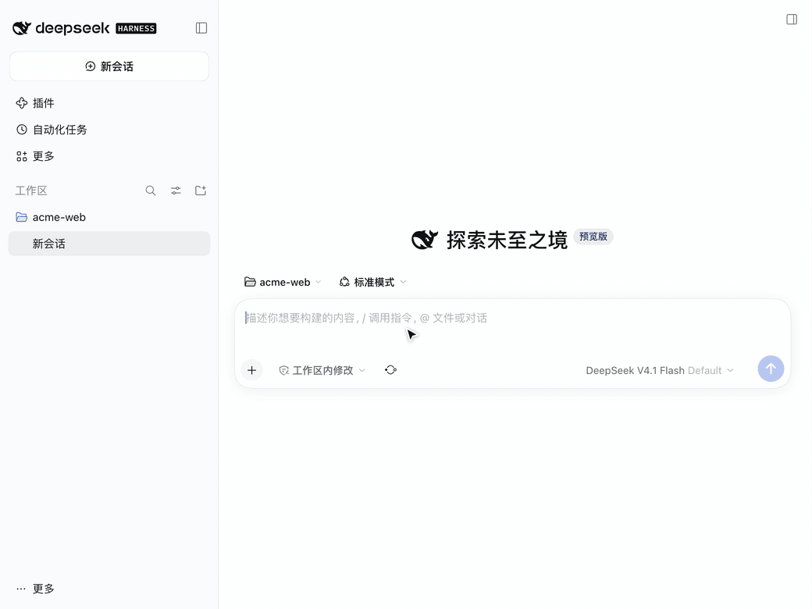
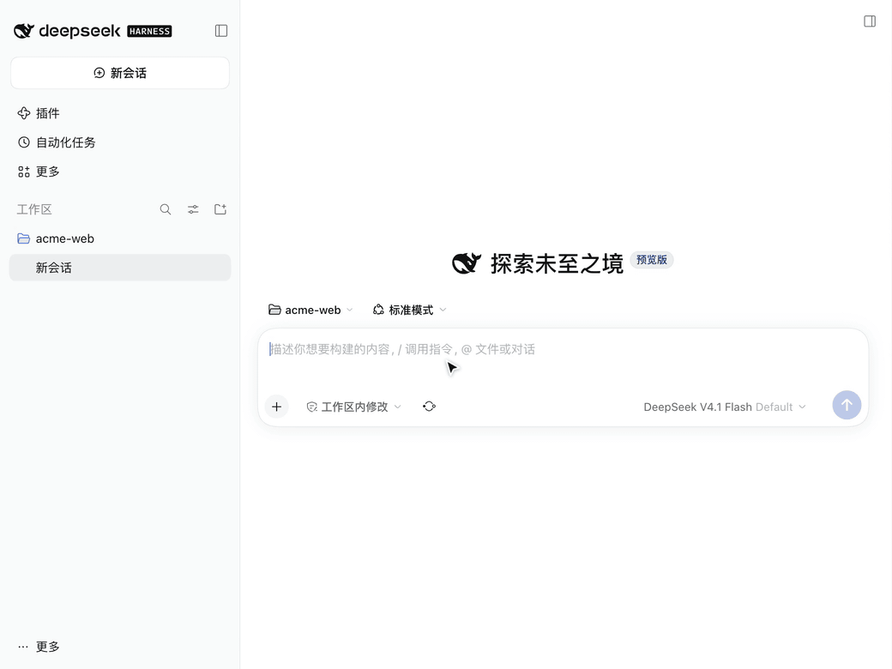

# Agent 扩展

`dsh-agent-plugins-market`

**DeepSeek Harness（DSH）里一站式的技能、子代理、MCP 与 LSP 管理器。**

在 DSH 中直接运行 Claude Code、Codex、Cursor、Kimi 与 agent-plugins 套件。插件就地读取各种布局，你不必转换清单，也不必复制文件。在 DSH 图形界面里安装本插件，之后在一个工作区里管理技能、命令、代理角色、MCP 服务与 LSP 服务，再用扩展预设决定每个会话带哪些扩展。

如果这个插件对你有用，欢迎在 [GitHub](https://github.com/Sivan757/dsh-agent-plugins-market) 点一个 ⭐。

[English](README.md) | 简体中文 | [在线文档](https://sivan757.github.io/dsh-agent-plugins-market/) | [npm](https://www.npmjs.com/package/dsh-agent-plugins-market)

 

[演示](#演示) · [快速开始](#快速开始) · [功能亮点](#功能亮点) · [日常使用](#日常使用) · [兼容性](#兼容性) · [常见问题](#常见问题)

## 演示

1. **添加来源。** 粘贴一个仓库地址，市场列出其中的套件。
2. **安装套件。** 插件就地读取套件，不转换清单，也不复制文件。
3. **保存预设。** 在输入框旁打开预设管理器，另存一份，只留这次要用的套件。
4. **切换预设。** 会话只带选中的扩展，`/` 菜单随之变短。
5. **直接开工。** 同一套扩展，每个会话各取所需。

演示使用第一方来源与 [claude-plugins-official](https://github.com/anthropics/claude-plugins-official)。点击动图可打开高清视频。

## 快速开始

1. 在 DSH 图形界面中打开侧边栏的**插件**页。
2. 点**添加插件**，填入 `dsh-agent-plugins-market`，然后安装。同一个对话框也接受仓库地址或本地目录。
3. 重启 DSH，然后打开**设置 → Agent 扩展**。
4. 市场里已经列出一个第一方来源。点**刷新**即可拉取其中的套件。想补充更多内容时再添加来源，例如 `https://github.com/anthropics/claude-plugins-official`。
5. 打开套件查看内容，确认后安装并保持启用。技能会出现在**技能**页签和聊天中的 `/` 菜单里；如果套件提供 MCP，先在**连接器**页签处理凭据提示，再使用它的工具。

命令行替代方式：`dsh plugin --profile <name> add dsh-agent-plugins-market`。环境要求、profile 配置与其他安装方式见[安装指南](https://sivan757.github.io/dsh-agent-plugins-market/docs/zh/install/#其他安装方式)。

## 功能亮点

### 核心能力

- **任何技能仓库都能用。** 仓库里只要有 `skills/<名称>/SKILL.md`，把地址加为来源就能发现套件。不需要清单，不需要转换，不需要复制文件。
- **十种套件布局。** Claude Code、Codex、Cursor、Kimi Code、ZCode、Qoder CLI、GitHub Copilot CLI、通用 `.plugin/`、[agent-plugins](https://agent-plugins.org) 以及无清单的技能集合。
- **来源与下载。** 添加 Git 仓库、本地目录或压缩包，也可以接管你自己克隆的检出目录并随时刷新。镜像线路可选全球或中国大陆；需要时还可以每 6 小时自动刷新全部来源。
- **运行时注入。** 启用套件后，技能进入技能目录与斜杠菜单，命令成为 `/名称`，代理角色进入子代理目录，MCP 工具以 `mcp__*` 前缀出现，hooks 挂到宿主生命周期事件，语言服务器接入 `lsp` 工具；LSP 装上插件即完成配置。
- **一个工作区。** 九个页签覆盖市场、注入会话的指令、塑造每次回答的输出风格、你自己创作的内容与正在运行的服务，都支持搜索、筛选和卡片或列表视图。
- **按会话取用的扩展预设。** 把一组套件、技能、专家、快捷指令与服务存成预设，在输入框旁切换。会话只带预设选中的扩展，全局开关保持不变。详见[会话扩展预设](https://sivan757.github.io/dsh-agent-plugins-market/docs/zh/settings/#会话扩展预设)。

### 进阶能力

- **MCP OAuth，无需声明。** 远端 MCP 服务返回 `401` 时，自动完成 RFC 9728 发现、动态客户端注册与 PKCE 授权，浏览器授权后令牌持久保存。OAuth 默认开启，套件不需要为此写任何声明。
- **逐个 MCP 服务精调。** 不改动来源就能覆盖某条声明，单独关闭某个工具，并设置工具调用与启动超时。
- **MCP 掉线会说出来。** 服务断线时在对话里说明第几次重试、所属套件与最近错误；不可用期间，模型的提示词里点名缺失的工具，回答会说明缺了什么，而不是悄悄绕开。
- **项目资源与自己创作的内容。** 打开**扫描项目 Agent 布局**后，无需安装即可读取项目自身目录中的技能、命令、角色、MCP 服务与 hooks。自己的内容放在 `~/.agents/` 下，以 Markdown 编写；停用资源不必删除文件。
- **按工作区生效的控制。** 每个工作区可以单独开关六类挂载能力，保留自己的资源筛选条件，把资源窗口配置存为可跨项目使用的收藏，还可以把用不到的页签收纳进页签行末尾的菜单。
- **Hooks 会真正生效，而不只是旁观。** 十个事件会应用 hook 返回的结果：工具拦截、确认与放行，补充上下文，纠正反馈，强制续跑，以及 `continue: false` 带来的真正中止。每个 hook 行都能打开声明卡，查看事件、匹配条件与超时，并在用户根目录试运行一次。[Hook 事件覆盖](docs/reference/hooks-event-coverage.md)列出了全部事件，以及宿主暂时无法应用的三个字段。
- **默认双语。** 界面与注入的提示词跟随宿主语言。描述与文档可显示原文、译文或双语，结果缓存在本地直到你清空缓存。

## 日常使用

安装套件只是起点。在同一个工作区里，你可以自己写、自己改：

1. **写一个技能。** 一份带 `name` 与 `description` 的 Markdown，创建后立即生效。
2. **编辑系统提示词。** 查看注入系统提示词的 AGENTS.md 文件，直接新建或修改。
3. **关掉用不到的工具。** 在连接器里逐个勾选 MCP 工具，取消勾选的工具不再提供给模型。
4. **选一个输出风格。** 用一段文字决定模型怎么回答，不必为此写一个插件。

工作区包含九个页签：

| 页签       | 可以做什么                                              |
| ---------- | ------------------------------------------------------- |
| 市场       | 添加来源、预览套件、安装或卸载，以及启用或停用。        |
| 技能       | 浏览技能，创建或编辑自己的可复用指令。                  |
| 专家       | 保存角色指令与模型配置，然后委派给它们。                |
| 快捷指令   | 管理通过 `/名称` 调用的提示词模板。                     |
| 连接器     | 新增服务，或配置已安装的服务及其凭据与授权。            |
| 语言引擎   | 新增并配置语言服务器，查看运行状态。                    |
| 系统提示词 | 查看注入其中的 AGENTS.md 文件，并创建、编辑或删除它们。 |
| 输出风格   | 选择塑造模型回答方式的指令文本。                        |
| 钩子       | 查看已配置的 hook 及其事件、匹配条件与超时。            |

**来源（source）**表示内容来自哪里，**套件（suite）**是从中发现的可安装单元。添加来源用于发现套件，启用套件决定其运行时能力是否生效。

会话启动与资源面板读取包含已安装套件的来源。托管来源跨重启复用发现索引。本地与收编来源在读取时按需复查已安装套件的目录。打开市场时，才按需发现其他已配置来源。编辑何时可见，见[发现与刷新](docs/user/sources.zh.md#发现与刷新)。

你自己创作的内容都放在 `~/.agents/` 下：技能、命令和角色是 Markdown 文件，hooks 放在 `hooks.json`，工作区里新增的 MCP 与 LSP 服务分别保存在 `mcp.json` 与 `lsp.json`。[指令指南](https://sivan757.github.io/dsh-agent-plugins-market/docs/zh/instructions/)说明宿主注入的 AGENTS.md 链条与编辑它的页面，[输出风格指南](https://sivan757.github.io/dsh-agent-plugins-market/docs/zh/output-styles/)说明塑造每次回答的那段文本。项目原生资源继续保留在项目中。路径与优先级见[存储与发现](https://sivan757.github.io/dsh-agent-plugins-market/docs/zh/resources/#存储与发现)。

## 兼容性

插件读取十种布局方言，映射六类运行时能力。逐布局的支持情况与清单优先级见[兼容的插件市场](https://sivan757.github.io/dsh-agent-plugins-market/compatible-plugins/)。证据是[布局审计](https://github.com/Sivan757/dsh-agent-plugins-market/blob/main/docs/user/layout-coverage.zh.md)与[兼容性报告](https://github.com/Sivan757/dsh-agent-plugins-market/blob/main/docs/reference/compat-report.md)。

能读取某种布局，不等于它的每个行为都与原平台一致。无效声明会被诊断并跳过，不会只挂载一半。

## 常见问题

**已安装的技能或工具为什么不见了？**

先确认套件与对应能力都已启用。**连接器**与**语言引擎**页签会报告失败和缺失的凭据。项目资源还需要打开项目扫描开关。

**MCP 的令牌在哪里配置？**

在**连接器**页签中打开该服务。缺失的环境引用会显示 `needs-credentials`。宿主托管的凭据是只写的。

**来源会自动刷新吗？**

只有打开**后台更新来源**时才会。它每 6 小时刷新一次全部已配置来源，并在启用后一个周期开始。刷新按钮始终可用。

**删除来源会删掉文件吗？**

只有你在确认框中勾选**同时删除托管的市场目录**时才会。位于 `.sources/` 之外的本地目录来源永远不会被删除。

更多问题见[常见问题](https://sivan757.github.io/dsh-agent-plugins-market/faq/)。

## 文档

- [安装指南](https://sivan757.github.io/dsh-agent-plugins-market/install/)：从环境要求到第一个套件，逐步说明。
- [使用指南](https://sivan757.github.io/dsh-agent-plugins-market/docs/)：按任务分页，从安装到工作区行为。
- [兼容的插件市场](https://sivan757.github.io/dsh-agent-plugins-market/compatible-plugins/)：布局、优先级与抽样验证。
- [插件规范](https://github.com/Sivan757/dsh-agent-plugins-market/blob/main/packages/market-catalog/schemas/README.md)：各布局的参考 schema，以及 [`com.deepseek.harness`](https://github.com/Sivan757/dsh-agent-plugins-market/blob/main/packages/market-catalog/schemas/com.deepseek.harness/spec.md) 扩展命名空间。
- [贡献指南](https://github.com/Sivan757/dsh-agent-plugins-market/blob/main/.github/CONTRIBUTING.md) · [安全策略](https://github.com/Sivan757/dsh-agent-plugins-market/blob/main/.github/SECURITY.md) · [更新日志](https://github.com/Sivan757/dsh-agent-plugins-market/blob/main/CHANGELOG.md) · [MIT 许可](https://github.com/Sivan757/dsh-agent-plugins-market/blob/main/LICENSE)。
- [领域词汇表](https://github.com/Sivan757/dsh-agent-plugins-market/blob/main/CONTEXT.md) · [代理角色](https://sivan757.github.io/dsh-agent-plugins-market/docs/zh/agent-roles/) · [发布流程](https://github.com/Sivan757/dsh-agent-plugins-market/blob/main/docs/developer/release/release-process.md)。

## 交流群

扫描二维码加入 **dsh-agent-plugins-market** 微信群，我们在这里答疑并收集功能建议。

  

